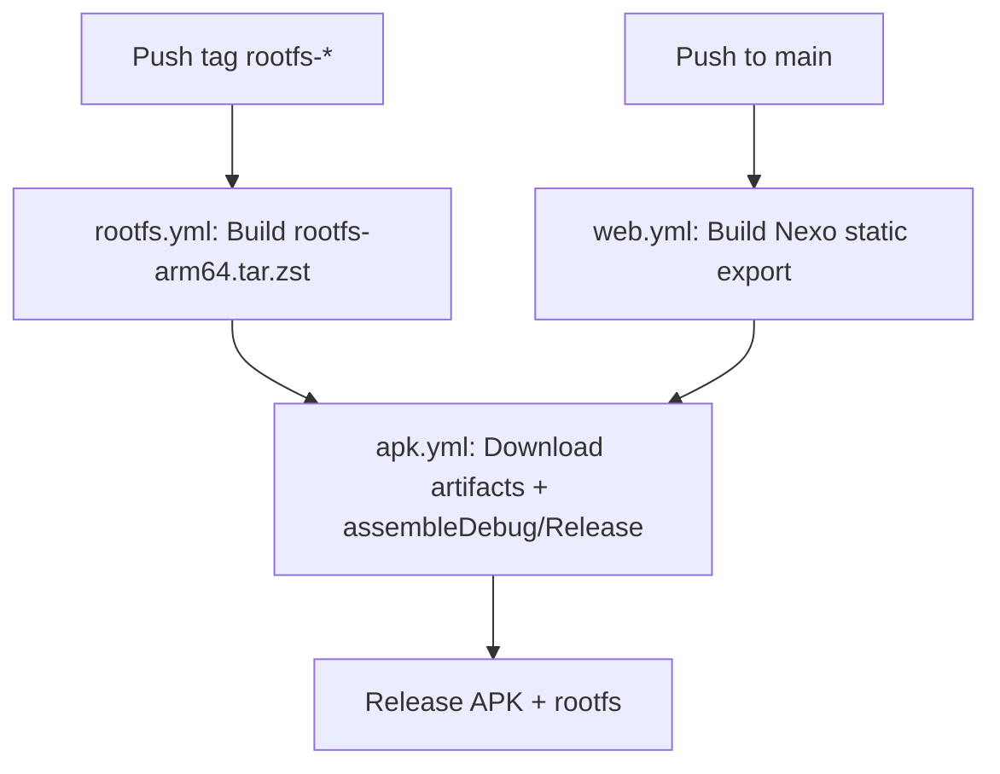

# Nexo APK — Hermes Agent Mobile

**Single APK with embedded Hermes backend + Nexo frontend (WebView)**

## Architecture

```
┌────────────────────────── APK (Kotlin) ──────────────────────────┐
│  MainActivity (WebView)      BackendService (foreground)          │
│        │  http://127.0.0.1:8700/?k=NONCE      │ proot             │
└────────┼──────────────────────────────────────┼──────────────────┘
         ▼                                      ▼
┌──────────────── rootfs Debian arm64 (glibc), dentro do proot ────────────────┐
│  nexo_edge.py (127.0.0.1:8700)  — serve Nexo estático + reverse proxy      │
│     ├─ /hx/api/*  → Hermes API server  127.0.0.1:8642  (+ Bearer injetado)  │
│     └─ /hx/dash/* → Hermes dashboard   127.0.0.1:9119  (+ token injetado)   │
│  hermes gateway   (API server + cron + plataformas)                         │
│  hermes dashboard (REST admin: config, skills, MCP, logs...)                │
│  supervisor.sh    (sobe os 3 processos, encerra tudo junto)                 │
└──────────────────────────────────────────────────────────────────────────────┘
```

## Project Structure

```
nexo/
├── android/                 # App Android (Kotlin + Compose)
│   ├── app/
│   │   ├── src/main/java/dev/nexo/app/
│   │   │   ├── NexoApplication.kt
│   │   │   ├── SecretStore.kt          # EncryptedSharedPreferences
│   │   │   ├── BootstrapManager.kt     # Download/verify/extract rootfs
│   │   │   ├── ProotRunner.kt          # Executa proot + supervisor
│   │   │   ├── BackendService.kt       # Foreground service + health check
│   │   │   ├── MainActivity.kt         # WebView + Compose UI
│   │   │   ├── BootReceiver.kt         # Auto-start no boot
│   │   │   └── ui/theme/Theme.kt
│   │   └── src/main/res/
│   └── build.gradle.kts
├── rootfs/                    # Docker build do rootfs Debian arm64
│   ├── Dockerfile             # Multi-stage: web-builder + final
│   ├── build-rootfs.sh        # Export .tar.zst + sha256
│   ├── overlay/               # Files copiados para o rootfs
│   │   ├── etc/resolv.conf
│   │   ├── opt/nexo/
│   │   │   ├── supervisor.sh   # Gerencia gateway + dashboard + edge
│   │   │   ├── nexo_edge.py    # Proxy reverso + estático (Starlette)
│   │   │   └── web/            # Nexo static export (copiado no build)
│   │   └── root/.hermes/config.yaml
│   └── versions.env           # HERMES_REF=v0.23.0
├── web/                       # Nexo Frontend (Next.js 14 + TS + Tailwind)
│   ├── src/app/page.tsx       # Dashboard principal
│   ├── src/components/providers.tsx
│   └── next.config.js         # output: 'export'
├── docs/analysis/             # Análise do repositório Hermes
│   ├── A1-extras.md ... A10-termux.md
│   ├── env.md, S2-medidas.md
├── .github/workflows/
│   ├── rootfs.yml             # Build rootfs (qemu arm64)
│   ├── web.yml                # Build Nexo static export
│   └── apk.yml                # Build APK (download rootfs artifact)
├── PROGRESS.md
├── BLOCKERS.md
├── DECISIONS.md
└── .gitignore
```

## Key Decisions (DECISIONS.md)

| Decision | Choice |
|----------|--------|
| **D1 Runtime** | proot + Debian glibc (fallback: Termux-bionic) |
| **D2 Processos** | 2: `hermes gateway run` (8642) + `hermes dashboard --no-open` (9119) |
| **D3 Transporte** | Edge proxy (`nexo_edge.py`) |
| **D4 Segurança** | Token forte (32 bytes/boot) + dashboard on-demand |
| **D5 Agendamentos** | Via API server (`/api/jobs`) |

## Build Pipeline



## Commands

```bash
# Build rootfs locally (requires Docker + buildx + qemu)
cd rootfs && ./build-rootfs.sh

# Build web static export
cd web && npm ci && npm run build

# Build APK (requires Android SDK)
cd android && ./gradlew assembleDebug

# CI: push tags
git tag rootfs-v0.23.0 && git push origin rootfs-v0.23.0
git tag v0.1.0 && git push origin v0.1.0
```

## Security

- **Loopback only**: Backend não expõe portas fora de 127.0.0.1
- **EncryptedSharedPreferences**: API keys, tokens no Keystore
- **Nonce por boot**: Cookie HMAC (nexo_s) + nonce único
- **Dashboard on-demand**: Só sobe quando usuário abre Configurações
- **allowBackup=false**: Dados não vão para backup do Google
- **network_security_config**: Cleartext apenas para localhost

## Limitations (Known)

- ❌ Browser tools (Chromium/Playwright)
- ❌ Computer Use (cua-driver)
- ❌ STT local (faster-whisper → ctranslate2/onnxruntime)
- ❌ Docker terminal backend
- ❌ Voice/Wake word (binários nativos)
- ✅ Terminal local, Files, Web Search (ddgs), Memory, Skills, Cron, MCP, Delegate, Execute Code, Vision, ACP, TTS (edge)

## License

MIT — exceto proot (GPLv3) que é binário separado em `jniLibs/`.

---

**Status**: Etapas 0–4 implementadas. Pronto para CI build e teste em dispositivo (Gate G4).